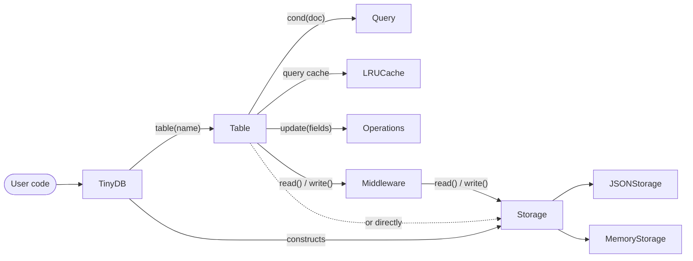

# TinyDB Architecture

## 1. Overview

TinyDB is a pure-Python, document-oriented database. The whole database is one
nested `dict` (`{table_name: {doc_id: document}}`, see the docstring in
`tinydb/database.py:48-66`). A pluggable storage persists that dict, and tables
work on their slice of it.

### Main components

| Component | File | Responsibility |
|---|---|---|
| **TinyDB** | `tinydb/database.py` | Entry point. Builds the storage instance (`storage(*args, **kwargs)`, line 95), keeps a `dict` of open `Table` objects (`table()`, lines 111-133), and drops tables. Forwards unknown attributes, `__len__`, and `__iter__` to the `_default` table (lines 251-274). |
| **Table / Document** | `tinydb/table.py` | Every document operation: `insert`, `search`, `get`, `update`, `upsert`, `remove`, `truncate`. Assigns document IDs (`_get_next_id`) and owns a per-table query cache. `Document` is a `dict` subclass that adds `doc_id`. |
| **Query / QueryInstance** | `tinydb/queries.py` | Query builder (`Query`, `where`). A query compiles to a `QueryInstance`, a callable `Mapping -> bool` with a stable hash. `QueryLike` is the protocol that `Table` accepts. |
| **Storage** | `tinydb/storages.py` | Abstract base class `Storage` with `read()`, `write()`, and an optional `close()`. Two implementations: `JSONStorage` (one file per database, `json.load`/`json.dumps`, with `fsync` on write) and `MemoryStorage`. |
| **Middleware** | `tinydb/middlewares.py` | Wraps a storage class and stands in for it. `CachingMiddleware` keeps the database dict in memory and writes it to the wrapped storage every `WRITE_CACHE_SIZE` (1000) writes, on `flush()`, and on `close()`. |
| **Operations** | `tinydb/operations.py` | Factories (`delete`, `add`, `subtract`, `set`, `increment`, `decrement`) that return `Callable[[MutableMapping], None]`. `Table.update` applies them in place. |
| **Utils** | `tinydb/utils.py` (+ `tinydb/mypy_plugin.py`) | `LRUCache` (the query cache), `freeze`/`FrozenDict` (make query arguments hashable), and `with_typehint` (lets type checkers see `TinyDB` as a `Table`; the MyPy plugin hooks `tinydb.utils.with_typehint`, `mypy_plugin.py:20`). |

### Who calls whom

- User code calls `TinyDB`. `TinyDB` creates a `Storage` (or a `Middleware`)
  and creates `Table` objects, passing each one that same storage instance
  (`database.py:130`).
- `Table` calls `Storage.read()`/`write()` only through `_read_table`
  (`table.py:779-802`) and `_update_table` (`table.py:804-854`). It calls the
  query objects (`cond(doc)`) and stores their results in `LRUCache`.
- `Query` uses only `utils.freeze`. It knows nothing about tables or storages.
- `Middleware` looks like a `Storage` to `Table` and calls the wrapped storage.
- `operations` functions are passed by the user to `Table.update` as `fields`.

## 2. Architecture Decision Records

### ADR-1: The storage reads and writes the whole database; tables read, modify, and write it back

- **Status:** Verified
- **Context:** Storages have to be easy to write (JSON, in-memory, YAML in
  `tests/test_storages.py:214`). Tables still need to change single documents.
- **Decision:** `Storage` has two abstract methods.
  `read() -> Optional[dict[str, dict[str, Any]]]` returns the whole database,
  or `None` when the storage is empty. `write(data)` replaces the whole database
  (`storages.py:47-69`). `Table._update_table` reads everything, turns the keys
  into `document_id_class`, runs an `updater(table)` closure, turns the keys
  back into `str`, writes everything, and clears the query cache. Evidence:
  - Code comment, `tinydb/table.py:808-812`: *"The storage interface used by
    TinyDB only allows to read/write the complete database data, but not
    modifying only portions of it. Thus, to only update portions of the table
    data, we first perform a read operation, perform the update on the table
    data and then write the updated data back to the storage."*
  - Commit `128ee57` "refactor(table): rename internal read/update methods"
    introduced the current `_read_table`/`_update_table` names.
  - Commit `50d0cd8` "refactor: use new architecture" ("See rationale and
    details in #284") added `Table._read`/`Table._update`, then still inside
    `tinydb/database.py`. Commit `63fcad6` "refactor: add type annotations"
    moved them to `tinydb/table.py`.
- **Alternatives considered:** A per-document or per-table storage API, such as
  insert/update/delete primitives. The code does not have one. Commit `2a2abe5`
  (atomic writes to a temporary file, #468) was reverted in `5694479`, so
  `JSONStorage.write` still overwrites the file in place: `seek(0)`, `write`,
  `fsync`, `truncate` (`storages.py:142-161`).
- **Consequences:** A new storage only needs to implement two methods. Every
  write costs O(size of the database), and every operation reads the storage
  at least once. `tests/test_storages.py:158-192` (`test_read_once`) checks the
  exact number of reads. Performance work belongs in middlewares such as
  `CachingMiddleware`. Each `_update_table` call does exactly one `write()`.

### ADR-2: Queries carry a stable hash and serve as keys of a per-table LRU result cache

- **Status:** Verified
- **Context:** `Table.search` scans every document. The same query is often
  run again with no write in between.
- **Decision:** Each `QueryInstance` gets a `hashval` tuple that describes it
  uniquely: the operator, `self._path`, and the `freeze()`d arguments. Its
  `__hash__`/`__eq__` use that tuple (`queries.py:99-112`). Combinators hash
  commutatively with `frozenset` (`queries.py:116-134`). `Table.search` looks
  the query up in `self._query_cache`, an `LRUCache` with
  `default_query_cache_capacity = 10`, and stores a copy of the result list only
  when `is_cacheable()` returns true (`table.py:265-295`). Every
  `_update_table` call clears the cache (`table.py:854`). Evidence:
  - Code comment, `tinydb/queries.py:71-73`: *"In order to be usable in a query
    cache, a query needs to have a stable hash value with the same query always
    returning the same hash."*
  - Commit `1fa99fb` "fix: make query callables work again" (Fixes #454): a
    query without `is_cacheable` counts as cacheable, *"to keep consistency
    with TinyDB's earlier behavior which assumed that all queries are
    cacheable"* (also the comment at `table.py:286-290`).
  - Commit `f200118` "feat: support `map` query operation (#445)": *"Mark
    callables as noncacheable"* (`queries.py:525-527`).
  - Commit `e83efcd` "fix: include regex flags in matches/search query hash
    (#640)", Fixes #637: queries that differed only in their flags *"shared a
    Table query-cache entry"*.
  - Commit `770486f` "fix: freeze unhashable args in Query.test to prevent
    TypeError (#618)".
- **Alternatives considered:** No cache, or invalidating only the affected
  entries. The code clears the whole cache on any write. The docstring at
  `table.py:48-50` says: *"When writing data, the whole cache is discarded"*.
- **Consequences:** A missing field in `hashval` makes different queries share
  a cache entry (the #637 bug). Values that cannot be hashed make a query
  uncacheable instead of raising (`queries.py:78-84`). Cached `Document`
  objects are shared with callers, who must treat them as read-only
  (`table.py:253-257`). A write made by another process, or by another `Table`
  object for the same name, does not clear this table's cache.

### ADR-3: Middlewares wrap the storage *class* and are constructed through `__call__`

- **Status:** Verified
- **Context:** `TinyDB.__init__` always runs `storage(*args, **kwargs)`
  (`database.py:92-95`). Users still want to add behaviour such as caching
  around any storage without changing `TinyDB`.
- **Decision:** `Middleware.__init__(storage_cls)` stores the class. Calling
  the middleware instance creates the real storage with TinyDB's arguments and
  returns `self` (`middlewares.py:21-65`). Any other attribute is forwarded to
  the wrapped storage (`middlewares.py:67-73`). Evidence: the docstring at
  `tinydb/middlewares.py:41-60` shows `TinyDB(storage=Middleware(StorageClass))`
  and explains *"when running ``self.storage = storage(*args, **kwargs)``
  Python now will call ``__call__`` ... In case of nested Middlewares, calling
  the instance as if it was a class results in calling ``__call__`` what
  initializes the next nested Middleware"*. Nesting is tested in
  `tests/test_middlewares.py:79` (`test_nested`).
- **Alternatives considered:** Passing a storage *instance* to `TinyDB`, or
  subclassing each storage. The code passes a class or a callable that returns
  a storage.
- **Consequences:** `Middleware` does not subclass `Storage`, so it relies on
  duck typing. Subclasses must call `super().__init__(storage_cls)`
  (`middlewares.py:17-18`, `89-90`). `CachingMiddleware` must flush in
  `close()`, and after `close()` it raises `ValueError` on use (commit `18d73a1`
  "fix: reject CachingMiddleware reads and writes after close (#634)").

## 3. Constraints

1. **A new storage must subclass `Storage` and implement whole-database `read()`
   and `write()`. `read()` returns `None` for an empty store.** Both methods are
   `@abstractmethod` (`tinydb/storages.py:47-69`), so a subclass that skips one
   cannot be created (`tests/test_storages.py:149-155`). Callers depend on the
   `None` contract: `TinyDB.tables` (`database.py:161`),
   `TinyDB.drop_table` (`database.py:191`), `Table._read_table`
   (`table.py:791-793`), and `Table._update_table` (`table.py:820-822`).

2. **Every change to table data must go through `Table._update_table(updater)`.**
   That method alone converts the IDs, writes to the storage, and calls
   `clear_cache()` (`tinydb/table.py:804-854`). A method that writes to
   `self._storage` directly leaves stale results in the query cache. Read paths
   must use `_read_table` (`table.py:779-802`). The exact number of storage
   reads is pinned by `tests/test_storages.py:158-192`.

3. **The storage keeps document IDs as `str` keys. `Table` turns them into
   `document_id_class` only at the boundary.** `_update_table` turns them into
   `document_id_class` before the updater runs and back into `str` before
   `write` (`table.py:834-848`), because JSON has only string keys (comment at
   `table.py:842-844`). Lookups on raw table data must use `str(doc_id)`
   (`Table.get`, `table.py:363` and `377`). Results must wrap documents as
   `self.document_class(doc, self.document_id_class(doc_id))` (for example
   `table.py:273`, `742`).

4. **Every `Query` test must pass a `hashval` that fully describes it: the
   operator name, `self._path`, and every argument through `freeze()`. It must
   use `None` (uncacheable) when the result can change for the same input.** See
   `Query._generate_test` (`tinydb/queries.py:218-252`), the flags in the hash
   (`queries.py:358-360`, `379-381`), `Query.test` freezing its `*args`
   (`queries.py:405`), and `Query.map` setting `_hash = None`
   (`queries.py:525-527`). Tests: `tests/test_queries.py:188`
   (`test_regex_flags_affect_hash_and_query_cache`) and `:435` (`test_hash`).

5. **Keep the module dependency direction: `utils` ← `queries` ← `table` ←
   `database`, with `storages` as a leaf. `queries.py` must not import
   `table.py`, and `table.py` must not import `database.py`.** Current imports:
   `queries.py:23` imports only `.utils`. `storages.py:6-11` imports only the
   standard library. `table.py:15-17` imports `.queries`, `.storages`, and
   `.utils`. `database.py:7` gets `JSONStorage` from the package itself
   (`from . import JSONStorage`), so `tinydb/__init__.py` must import
   `.storages` (line 29) before `.database` (line 30). `middlewares.py:7` also
   imports `Storage` from the package root.
